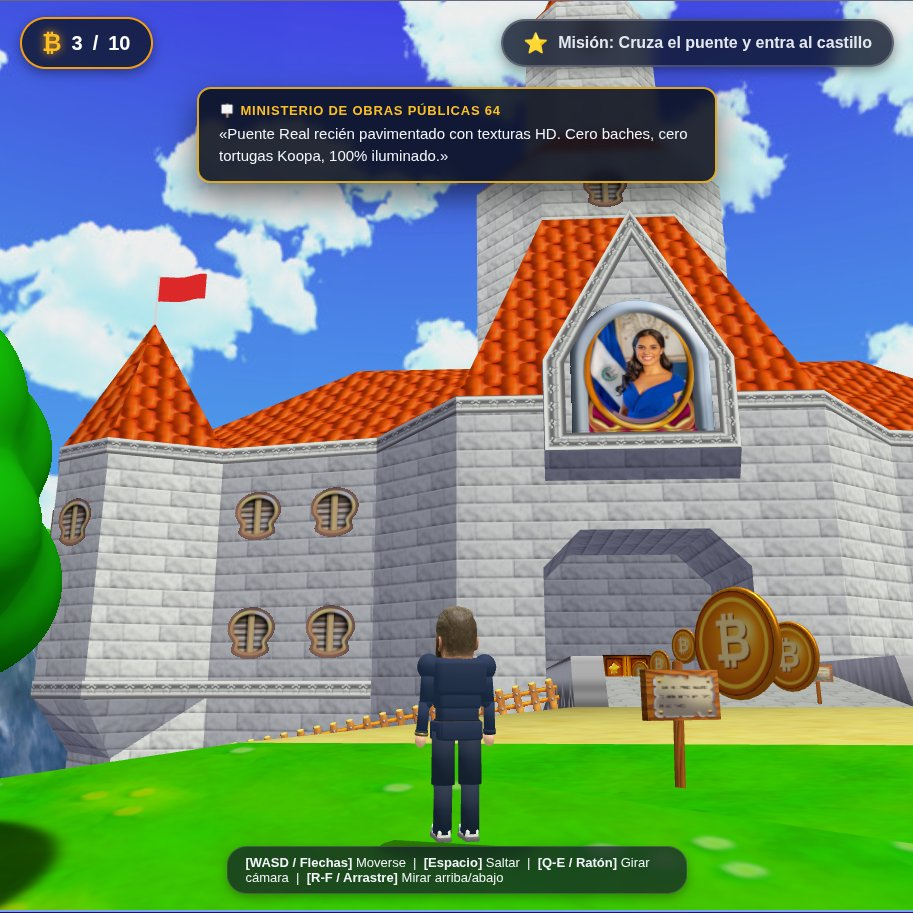

# 🏰 Super Bukele 64

> **Homenaje tridimensional interactivo en WebGL (Three.js) a *Super Mario 64*, desarrollado bajo la metodología de Vibecoding Guiado con Inteligencia Artificial.**  
> Entregable oficial de la Actividad Semana 2 — **AI FOR DEVS JR. 5 (Kodigo Academy)**.

  
  
  

---

## 🕹️ [▶ HAZ CLIC AQUÍ PARA ENTRAR A JUGAR AHORA](https://robert-flo.github.io/pj-vibe-game/)
### **`https://robert-flo.github.io/pj-vibe-game/`**
*100% operativo en el navegador web • Compatible con PC, Mac y dispositivos móviles • Sin descargas ni emuladores • Audio original de Nintendo 64*

---

  
   
  <em>Gameplay real de Super Bukele 64: nivel exterior Peach's Castle Grounds HD, vitral de la Primera Dama Gabriela de Bukele en el pórtico, locomoción orgánica con zapatillas 3D niveladas, Bitcoin coleccionable y carteles interactivos del Ministerio de Obras Públicas 64.</em>

---

## 📌 Enlaces Oficiales del Proyecto

| Recurso / Entregable | Descripción | Enlace Permanente |
| :--- | :--- | :--- |
| 🎮 **Videojuego 3D en Vivo** | Despliegue interactivo en WebGL / Three.js con flujo canónico de 6 escenas. | [robert-flo.github.io/pj-vibe-game/](https://robert-flo.github.io/pj-vibe-game/) |
| 📚 **Portal de Documentación Académica** | Memoria técnica completa, bitácora de 26 prompts, matriz de iteraciones y 18 incidencias resueltas. | [robert-flo.github.io/pj-vibe-game-docs/](https://robert-flo.github.io/pj-vibe-game-docs/) |
| 📁 **Repositorio del Motor del Juego** | Código fuente de la arquitectura WebGL, shaders GLSL, scripts de Blender y síntesis N64. | [github.com/robert-flo/pj-vibe-game](https://github.com/robert-flo/pj-vibe-game) |
| 📂 **Repositorio de Documentación** | Fuentes en Markdown del sitio Jekyll, evidencias empíricas y código del reporte oficial. | [github.com/robert-flo/pj-vibe-game-docs](https://github.com/robert-flo/pj-vibe-game-docs) |
| 📄 **Documento Oficial PDF** | Informe técnico A4 de 6 páginas en formato institucional Kodigo Academy. | [Descargar RobertoFlores-Tarea02.pdf](https://robert-flo.github.io/pj-vibe-game-docs/assets/docs/RobertoFlores-Tarea02.pdf) |

---

## 🌟 Características Principales

* **Flujo Canónico Completo (6 Escenas de Homenaje N64)**:
  1. **Escena 1 (Title Screen)**: Logotipo 3D facetado con textura de madera generado con la tipografía oficial `TypefaceMario64.otf` sobre mosaico acolchado azul N64.
  2. **Escena 2 (Interactive Head Screen)**: Busto tridimensional interactivo de Nayib Bukele con seguimiento elástico del cursor y estudio de iluminación cálida.
  3. **Escena 3 (SELECT FILE Screen)**: Tablero dorado con cursor 3D de mano enguantada N64 y 4 ranuras de partida (`BUKELE A, B, C, D`).
  4. **Escena 4 (La Carta de Gabriela)**: Carta formal donde la Primera Dama invita a Nayib al castillo, ambientada con el arpegio clásico de piano extraído de la ROM.
  5. **Escena 5 (Cinemática Lakitu)**: Vuelo aéreo cinemático cortado al segundo 49.0 (22.5s) hacia la tubería verde recién emergida en los jardines.
  6. **Escena 6 (Peach's Castle Grounds HD)**: Recreación del nivel exterior completo con listas de despliegue RSP (`Fast3D`), texturas HD de `RENDER96`, 26 árboles en billboard, cascada animada, 4 banderas ondeantes, carteles cómicos y 10 Bitcoins coleccionables.
  7. **Cinemática de Victoria**: Al cruzar el puente hacia el pórtico, las grandes puertas estelares se abren hacia afuera, Bukele entra sobre la alfombra roja al son de *"Here we go!"* y la fanfarria estelar, culminando en el modal de victoria con estadísticas de tiempo y monedas.

* **Héroe Jugable Nayib Bukele (Estilo Fortnite / 3D)**:
  - Proporción humana de 7.5 cabezas con silueta atlética (*V-taper*), saco entallado con pañuelo blanco en bolsillo, cinturón con hebilla de oro, reloj en muñeca izquierda y zapatillas deportivas 3D.
  - Cinemática de caminata y carrera orgánica con **articulación de tobillos FK (`FootL`/`FootR`)**, contrarrotación dinámica para mantener las suelas niveladas al suelo al avanzar y despegar, y flexión natural de rodillas.

* **Fachada del Castillo con Vitral de Gabriela de Bukele**:
  - Retrato oficial de la Primera Dama Gabriela de Bukele enmarcado en el vitral ovalado superior del castillo con bisel dorado de plomo, bandera de El Salvador y transparencia superior adaptada a la mampostería 3D.
  - Sistema de vitral personalizable dinámicamente mediante el parámetro URL `?glass=ruta/imagen.png` o consola `window.setCastleStainedGlass()`.

* **Banda Sonora y Efectos de Sonido Auténticos (OST SM64)**:
  - Saludo inicial de Mario *"It's-a Me, Mario!"* al comenzar.
  - *Title Theme* (3:34 min) en alta fidelidad para la pantalla de inicio.
  - *File Select Theme* (46 s) oficial para la pantalla dorada de archivos.
  - Efectos originales N64 de salto, recolección de Bitcoins, apertura de puertas y fanfarria estelar.

* **Soporte Multiplataforma Completo (PC / Móvil)**:
  - D-Pad táctil virtual y botón "A" de salto para navegación en dispositivos móviles y pantallas táctiles sin teclado.
  - Control de cámara orbital 3D con elevación vertical (*pitch*) mediante teclas R/F o arrastre con ratón/touch para admirar el castillo y las torres.

---

## 🎮 Controles del Juego

### Teclado y Ratón (Escritorio / PC)
| Tecla / Acción | Función |
| :--- | :--- |
| `W`, `A`, `S`, `D` / `Flechas` | Desplazar a Bukele en 3ª persona |
| `Espacio` | Saltar con voz clásica N64 |
| `Q` / `E` | Rotar cámara orbital lateralmente |
| `R` / `F` | Inclinar cámara verticalmente (mirar al cielo / castillo) |
| `Arrastre con Ratón` | Control de vista libre 360° y elevación |
| `Clic en Cartel` | Leer diálogo cómico estilo N64 |

### Pantalla Táctil (Móviles y Tablets)
| Elemento en Pantalla | Función |
| :--- | :--- |
| **Cruceta Virtual (D-Pad)** | Mover al personaje en cualquier dirección |
| **Botón Cian "A"** | Saltar |
| **Arrastre en Pantalla** | Rotar cámara orbital libremente |
| **Tap en Pantalla** | Interactuar con diálogos y avanzar escenas |

---

## 🛠️ Arquitectura Tecnológica y Fuentes de Texturas

* **Motor Gráfico**: Three.js (WebGL ES Modules) sin empaquetadores opacos para máxima transparencia técnica.
* **Modelado y Scripts Offline**: Blender 5.2.2 LTS con scripts en Python para compilación geométrica GLB y horneado UV.
* **Audio**: Extracción y síntesis de secuencias `.m64` y bancos PCM `.aiff` desde la ROM original norteamericana de SM64 con NumPy y Web Audio API.
* **Control de Versiones y Despliegue**: Git con commits atómicos granulares y despliegue automatizado mediante GitHub Pages.

### 🌐 Repositorios Externos de Texturas y Descompilación
* **Paquete de Texturas HD**: [RENDER96-HD-TEXTURE-PACK](https://github.com/pokeheadroom/RENDER96-HD-TEXTURE-PACK) (pokeheadroom / Render96 Team) — Muros, senderos, césped HD, árboles y agua.
* **Descompilación C y Listas RSP**: [Render96ex](https://github.com/Render96/Render96ex) (Render96 Team) — Geometría N64 Fast3D de `levels/castle_grounds/areas/1/`.

---

## 🎓 Información Académica

* **Programa**: AI FOR DEVS JR. 5 (Kodigo Academy)
* **Actividad**: Semana 2 — Vibecoding Guiado
* **Estudiante**: Roberto Carlos Flores Quintanilla
* **Instructor**: Ing. Ronald Mejia
* **Fecha de Entrega Oficial**: 1 de Noviembre de 2026
